<div align="center">

> [!WARNING]
> **온라인 게임에서는 사용하지 마세요.**
> 이 프로그램은 키보드를 대신 눌러 주는 방식이라, 게임 보안 프로그램이 매크로로 오해할 수 있어요.
> 게임 계정이 제한될 수 있으니 게임 중에는 꺼 두세요.

## 💡 왜 만들었나요?

스트림 덱처럼 버튼 하나로 프로그램을 열고 단축키를 누르는 도구를 컴퓨터 화면에서도 쓸 수 있다고 해서 찾아봤어요. 그런데 유료 기능이 있고 디자인도 제 취향이 아니어서, "그럼 내 방식대로 만들어 보자" 라는 생각으로 시작했어요.

무료로, 화면 위에 예쁘게 떠 있고, 처음 쓰는 사람도 쉽게 쓸 수 있는 버튼판을 목표로 만들었어요.

<sub>Virtual Deck 은 Elgato 및 Stream Deck 과 관련 없는 개인 프로젝트예요.</sub>

---

## 🚀 다운로드 (바로 설치하고 쓰기)

| 종류                       | 파일 이름                       | 크기              | 설명                                                                          | 다운로드                                                                                                           |
| -------------------------- | ------------------------------- | ----------------- | ----------------------------------------------------------------------------- | ------------------------------------------------------------------------------------------------------------------ |
| **설치 파일 (추천)** | `VirtualDeck-1.9.3-Setup.exe` | **38.5 MB** | 시작 메뉴와 바탕화면에 바로가기를 만들고, 제어판에서 언제든 삭제할 수 있어요. | [**다운로드 (Setup.exe)**](https://github.com/sh11025/Virtual_Deck/raw/main/dist/VirtualDeck-1.9.3-Setup.exe) |

> [!TIP]
> **파란색 'Windows의 PC 보호' 창이 뜨나요?**
> 아직 널리 알려지지 않은 새 프로그램이라 Windows가 보여주는 정상적인 보안 안내입니다.
> **`추가 정보`** 를 누른 뒤 **`실행`** 버튼을 누르면 정상적으로 시작됩니다.

---

## ⚡ 3단계로 시작하기

1. **설치 후 실행**: 다운로드한 설치 파일을 실행하면 바탕화면에 투명한 유리 버튼판이 나타납니다.
2. **버튼 우클릭 → 편집**: 아무 버튼이나 마우스 오른쪽 버튼으로 누르고 **`편집`** 을 누릅니다.
3. **할 일 고르고 저장**: 단축키나 자주 쓰는 프로그램을 고르고 **`저장`** 하면 즉시 나만의 전용 버튼이 완성됩니다!

### 🎁 바로 쓸 수 있는 프로필 예시 모음

자주 쓰는 프로그램과 일상 작업에 맞춘 10가지 예시 프로필이 준비되어 있어, 따로 설정하지 않고 바로 쓸 수 있어요.

| 프로필 이름             | 들어 있는 버튼                                                                                              | 자동으로 바뀌는 프로그램                                         |
| ----------------------- | ----------------------------------------------------------------------------------------------------------- | ---------------------------------------------------------------- |
| **기본**          | 네이버, 유튜브, 화면 캡처, 계산기, 탐색기, 다운로드, 바탕화면, 재생/정지, 볼륨 -, 음소거, 볼륨 +, 더보기    | 기본 버튼판                                                      |
| **공부·집중**    | 집중 25분, 쉬기 5분, 스톱워치, 시계, 유튜브, 재생/정지, 음소거                                              | -                                                                |
| **인터넷**        | 뒤로, 새로고침, 앞으로, 새 탭, 탭 닫기, 닫은 탭 열기, 즐겨찾기, 확대, 축소                                  | 크롬, 엣지, 웨일 (`chrome.exe`, `msedge.exe`, `whale.exe`) |
| **한글**          | 저장, 다른 이름, 글자 모양, 문단 모양, 쪽 나누기, 맞춤법, 인쇄, 되돌리기, 문자표                            | 한글 (`Hwp.exe`)                                               |
| **워드**          | 저장, 굵게, 가운데, 쪽 나누기, 찾아 바꾸기, 인쇄, 되돌리기, 다시 실행                                       | 워드 (`WINWORD.EXE`)                                           |
| **엑셀**          | 저장, 되돌리기, 다시 실행, 필터, 합계, 오늘 날짜, 셀 서식, 찾기                                             | 엑셀 (`EXCEL.EXE`)                                             |
| **파워포인트**    | 새 슬라이드, 처음부터, 지금부터, 복제, 그룹, 그룹 해제, 저장, 되돌리기                                      | 파워포인트 (`POWERPNT.EXE`)                                    |
| **포토샵**        | 이동, 브러시, 지우개, 자유 변형, 새 레이어, 되돌리기, 다시 실행, 저장, 내보내기                             | 포토샵 (`Photoshop.exe`)                                       |
| **프리미어 프로** | 선택, 자르기, 편집 추가, 잔물결 삭제, 재생/정지, 마커, 확대, 축소, 내보내기                                 | 프리미어 프로 (`Adobe Premiere Pro.exe`)                       |
| **AI 모음**       | Claude·ChatGPT·Gemini·Antigravity 앱을 바로 실행하고 사용량 페이지를 열어요(설치된 앱은 자동으로 찾아요) | -                                                                |

---

## 🌟 이런 것들을 할 수 있어요

- **더 읽기 쉬운 환경설정 & 글자 크기 조절**: 작게/보통/크게 3단계 글자 크기 조절과 간결하고 직관적인 문구로 환경설정을 한눈에 편안하게 볼 수 있어요.
- **버튼 색 18가지 + 직접 고르는 색(내 색 저장)**: 청록·연두·남색 등 18가지 기본 유리 색과 함께 `+` 버튼으로 원하는 색을 자유롭게 골라 내 색(최대 12개)으로 저장할 수 있어요.
- **아이콘 색에 맞춰 글자색도 바뀜**: 아이콘 색을 바꾸면 글자색도 자연스럽게 함께 바뀌고, 바탕과 겹쳐 읽기 어려울 땐 명암비를 계산해 또렷하게 보정해요.
- **글꼴 선택**: 기본 Pretendard 외에도 내 PC에 설치된 한글 글꼴을 골라 바로 적용할 수 있어요.

<div align="center">
  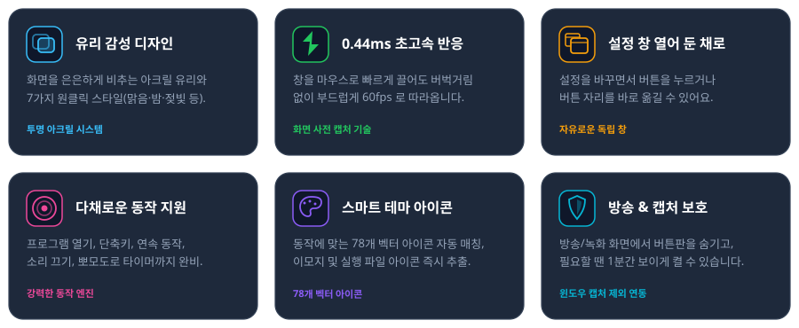
  <br/><br/>
  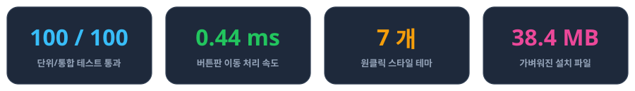
</div>

<br/>

### 🎯 누르면 실행할 수 있는 동작들

| 구분                        | 할 수 있는 일                                   | 실제 활용 예시                                                     |
| --------------------------- | ----------------------------------------------- | ------------------------------------------------------------------ |
| **단축키**            | 키보드 키 조합을 한 번에 전송                   | `Ctrl + Shift + S` (캡처), `Alt + Tab`, `Win + D` (바탕화면) |
| **프로그램 열기**     | 자주 쓰는 프로그램 바로 켜기                    | 메모장(`notepad.exe`), 계산기, 포토샵, 게임                      |
| **설치된 앱 실행**    | 설치된 앱에서 고르기(경로를 몰라도 돼요)        | Claude, ChatGPT, Gemini, 계산기 등 시작 메뉴 앱                    |
| **파일 / 폴더 열기**  | 자주 찾는 폴더를 탐색기로 열기                  | 작업 폴더, 다운로드 폴더, 매일 보는 엑셀 문서                      |
| **웹사이트 열기**     | 기본 브라우저로 사이트 접속                     | 유튜브, 넷플릭스, 사내 업무 포털                                   |
| **소리 조절**         | 볼륨 조절 및 음소거                             | 볼륨 올리기/내리기, 스피커 음소거, 마이크 끄기                     |
| **연속 동작**         | 여러 키와 글자를 순서대로 입력                  | 인사말 자동 입력, 저장 후 창 닫기(`Ctrl+S` → `Enter`)         |
| **타이머 (뽀모도로)** | 버튼 위에 남은 시간을 보여주며 카운트다운       | 25분 집중 타이머, 3분 라면 타이머, 알람 울림                       |
| **버튼 묶음**         | 버튼 하나에 하위 버튼판을 담아 페이지 확장      | 업무용 / 게임용 / 음악용 등 용도별 버튼판 정리                     |
| **프로필 이동**       | 버튼 하나로 다른 프로필(버튼판)로 바로 이동하기 | 게임용/작업용을 오가기, 다음 프로필로 돌려 보기                    |
| **스위치 버튼**       | 누를 때마다 켜짐/꺼짐 상태 유지                 | 마이크 토글, 방송 시작/종료 토글                                   |

---

## 📖 사용 방법 한눈에 보기

### 1. 버튼 편집 흐름

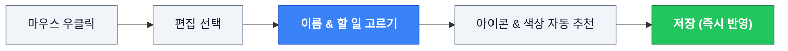

### 2. 위쪽 숨김 메뉴 (마우스 올리면 부드럽게 나타남)

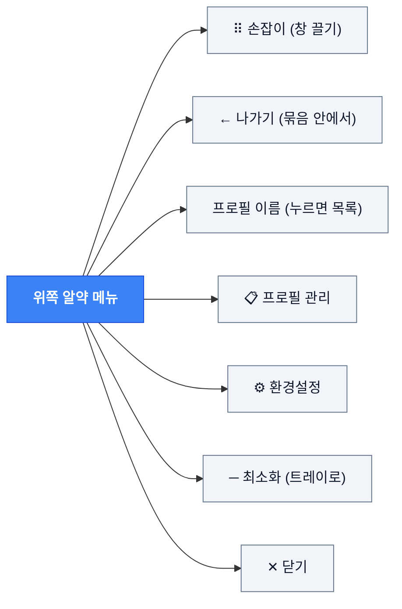

### 3. 환경설정 창 4개 탭 구조

```mermaid
flowchart TD
    classDef head fill:#3b82f6,stroke:#1d4ed8,color:#ffffff,font-weight:bold;
    classDef box fill:#f1f5f9,stroke:#64748b,color:#0f172a;
    classDef sub fill:#ffffff,stroke:#94a3b8,color:#0f172a;

    Config["환경설정 (바꾸면 바로 보여요)"]:::head

    Config --> T1["1. 꾸미기"]:::box
    T1 --> T1_1["7가지 유리 스타일"]:::sub
    T1 --> T1_2["밝은 테마 / 어두운 테마"]:::sub
    T1 --> T1_3["유리 맑기 슬라이더"]:::sub
    T1 --> T1_4["아이콘 모양 (선만 / 색 채움 / 이모지)"]:::sub
    T1 --> T1_5["글자 크기 조절 (작게 / 보통 / 크게)"]:::sub

    Config --> T2["2. 크기"]:::box
    T2 --> T2_1["가로 / 세로 (1~8)"]:::sub
    T2 --> T2_2["버튼 크기 (아주 작게 ~ 아주 크게)"]:::sub
    T2 --> T2_3["버튼 사이 간격 (좁게 / 보통 / 넓게)"]:::sub

    Config --> T3["3. 편리한 기능"]:::box
    T3 --> T3_1["항상 맨 위에"]:::sub
    T3 --> T3_2["단축키로 보이기/숨기기"]:::sub
    T3 --> T3_3["컴퓨터 켜면 자동 실행"]:::sub
    T3 --> T3_4["화면 끝에 붙기 & 안 쓸 때 흐리게"]:::sub

    Config --> T4["4. 더보기"]:::box
    T4 --> T4_1["배경 (단색 / 두 색 / 사진)"]:::sub
    T4 --> T4_2["설정 파일 내보내기 / 가져오기"]:::sub
    T4 --> T4_3["백업 되돌리기"]:::sub
```

<br/>

<div align="center">
  <table>
    <tr>
      <td align="center"><b>환경설정 창 (꾸미기 탭)</b></td>
      <td align="center"><b>버튼 설정 창</b></td>
    </tr>
    <tr>
      <td>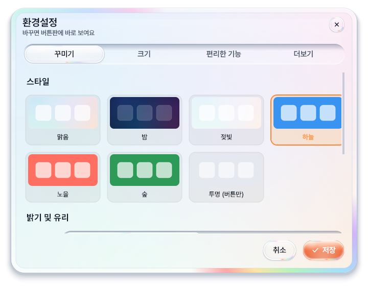</td>
      <td>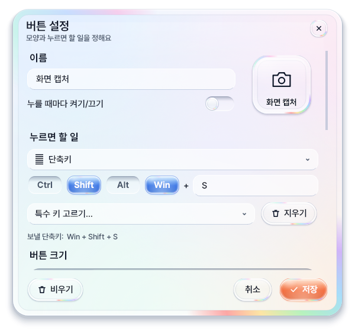</td>
    </tr>
  </table>
</div>

---

## ❓ 자주 묻는 질문 (FAQ)

**Q. 백신이 위험하다고 하거나, 파란 "Windows의 PC 보호" 창이 떠요.**

> A. 만든 사람 확인서(코드 서명)가 없는 개인 프로그램이라 생기는 일이에요. 키보드를 대신 누르고, 컴퓨터를 켤 때 자동 실행하는 기능 때문에 백신이 조심스럽게 보기도 해요. 파란 창은 "추가 정보 → 실행" 을 누르면 되고, 백신이 막으면 예외로 등록해 주세요.

**Q. 은행·관공서 사이트에서 단축키 버튼이 안 눌려요.**

> A. 이런 사이트의 키보드 보안 프로그램이 다른 프로그램의 키 입력을 막기 때문이에요. 정상이고, 그 사이트에서는 키보드로 직접 입력해 주세요.

**Q. 게임에서 써도 되나요?**

> A. 온라인 게임에서는 쓰지 마세요. 게임 보안 프로그램(안티치트)이 매크로로 오해해서 계정이 제한될 수 있어요.

**Q. 방송 프로그램(OBS)이나 디스코드 화면 공유에 버튼판이 안 보여요!**

> A. 개인정보 보호를 위해 방송·녹화 프로그램에서 자동으로 숨겨집니다. 화면에 보여주고 싶으시다면 작업표시줄 오른쪽 트레이 아이콘을 우클릭하고 **`캡처할 때 보이게 (1분)`** 을 누르면 1분 동안 화면 공유에 나타납니다.

**Q. 설정한 내용과 버튼들은 어디에 저장되나요?**

> A. 설치형 버전은 안전하게 사용자의 개인 앱 데이터 폴더(`%APPDATA%\VirtualDeck\data`)에 보관됩니다. 컴퓨터가 갑자기 꺼져도 직전 상태를 `.bak` 파일로 남겨두어 데이터가 안전하게 보호됩니다.

**Q. 설정 창을 띄워 둔 채로 버튼판을 조작할 수 있나요?**

> A. 네! Virtual Deck은 설정 창을 열어 둔 채로 버튼판을 자유롭게 클릭하거나 드래그해서 버튼 위치를 바꿀 수 있습니다.

**Q. 프로그램이 갑자기 꺼졌어요.**

> A. data 폴더의 crash.log 를 열어 마지막 몇 줄을 알려 주세요. '시작'이 두 번 이어지고 '정상 종료'가 없으면 갑자기 꺼진 거예요.

---

## 🗑️ 삭제하는 방법

- **설치형**: 윈도우 **`설정 → 앱 및 기능`** (또는 제어판)에서 **`Virtual Deck`** 을 찾아 [제거]를 누르면 깨끗하게 삭제됩니다.
- **휴대용**: 폴더 안의 **`완전 삭제.bat`** 을 실행하면 임시 파일과 레지스트리까지 말끔히 정리됩니다.

---

<details>
<summary><b>🛠️ 개발자용 세부 정보 (클릭하여 펼치기)</b></summary>

### 📁 프로젝트 폴더 구조

```text
Virtual Deck/
├── main.py                  # 프로그램 시작점 (단일 인스턴스 락, 트레이 아이콘)
├── build_exe.py             # 1-클릭 배포 파일 빌더 (PyInstaller + Inno Setup)
├── requirements.txt         # 파이썬 필요한 부품 (PySide6, pycaw 등)
├── run_tests.bat            # 100개 단위/통합 테스트 원클릭 실행 스크립트
├── save_to_git.bat          # 깃 저장소 커밋 자동화 스크립트
├── core/                    # OS 연동 및 백그라운드 엔진
│   ├── action_executor.py   # 단축키, 프로그램, 타이머 등 동작 실행
│   ├── macro_manager.py     # 연속 키 입력 매크로 엔진
│   ├── shortcut_manager.py  # 키보드 단축키 변환 및 가상 입력
│   ├── system_integration.py# Windows 전역 단축키 및 자동 시작 등록
│   ├── audio_state.py       # 시스템 볼륨/음소거 상태 감지
│   ├── icon_fetcher.py      # 실행 파일 및 URL 파비콘 추출
│   └── win32.py             # Win32 창 속성 및 캡처 방지 API
├── models/                  # 데이터 구조체
│   ├── button_model.py      # 버튼 데이터 구조 (DeckButtonData)
│   ├── config_model.py      # 환경설정 구조 (AppConfig)
│   └── profile_model.py     # 프로필 모델 (DeckProfile)
├── services/                # 저장소 서비스
│   └── storage_service.py   # 꺼져도 안 깨지게 임시 파일 교체 저장 및 .bak 백업
├── ui/                      # 그래픽 인터페이스 (PySide6)
│   ├── main_window.py       # 메인 버튼판 창 & 떠 있는 알약형 메뉴바
│   ├── deck_button.py       # 통 튀어오르는 반동 & 유리 덱 버튼
│   ├── glass.py             # 초고속 유리 그리기 엔진
│   ├── backdrop.py          # 화면 사전 캡처 및 배경 합성
│   ├── settings_dialog.py   # 720px 전면 개편 독립형 환경설정 창
│   ├── button_editor_dialog.py # 직관적 3지선다 버튼 설정 창
│   ├── widgets.py           # 물방울 스위치, 늘어나는 탭 등 유리 위젯
│   ├── icons.py             # 코드로 직접 그리는 78개 테마 벡터 아이콘
│   └── theme.py             # 색상 토큰 및 Pretendard 글꼴 로더
├── tests/                   # 품질 검증 테스트
│   ├── test_deck.py         # 100개 동작/통합 테스트 (화면 없는 모드)
│   └── perf_check.py        # 렌더링/드래그 속도 측정 스크립트
├── installer/               # 설치 관리자 리소스
│   ├── VirtualDeck.iss      # Inno Setup 스크립트 (한글 완벽 지원)
│   └── 완전 삭제.bat        # 휴대용 레지스트리/캐시 완전 삭제 스크립트
└── docs/                    # 개발 문서 및 가이드
    ├── 작업일지.md          # 1차~6차 상세 개발 일지
    ├── make_readme_images.py# README 그림 자동 생성기
    └── images/              # README 인포그래픽 및 그림 에셋
```

---

### 🏛️ 프로그램 구조도

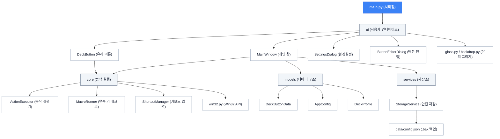

---

### ⏱️ 버튼 클릭 시 일어나는 일

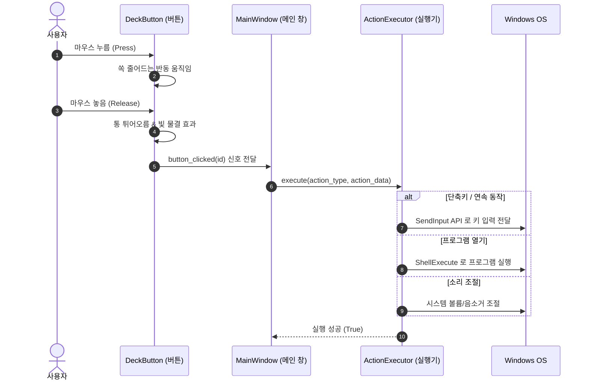

---

### 🎨 배경 유리 그리기 흐름

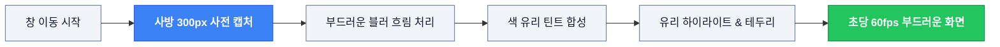

---

### 📦 배포 파일 만들기 흐름

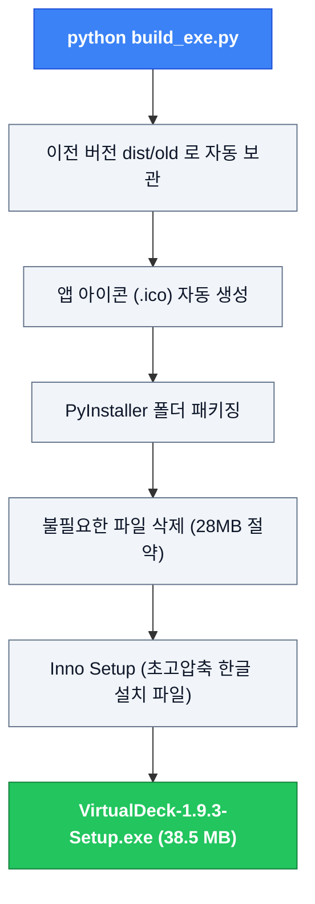

---

### ⚡ 속도 측정 결과 (6차 개선 기준)

`tests/perf_check.py` 기준 속도 측정 수치입니다:

| 측정 항목                                     | 개선 전  | 개선 후 (1.6.2)   | 개선 성과                              |
| --------------------------------------------- | -------- | ----------------- | -------------------------------------- |
| **창 끌기 시 이동 처리 시간**           | 66.8 ms  | **0.44 ms** | **약 150배 빨라짐** (60fps 유지) |
| **스타일 변경 시간 (`apply_config`)** | 117.8 ms | **73.4 ms** | **약 38% 단축** (0.07초 내 전환) |
| **4x4 버튼판 재배치/그리기**            | 62.8 ms  | **40.1 ms** | **약 36% 단축**                  |
| **버튼 마우스 올림 애니메이션 1프레임** | 2.1 ms   | **1.7 ms**  | 부드러운 움직임 보장                   |

---

### 💻 직접 실행 및 빌드 명령어

```powershell
# 1. 필요한 부품 설치
pip install -r requirements.txt

# 2. 프로그램 직접 실행
python main.py

# 3. 100개 단위/통합 테스트 실행
python tests/test_deck.py

# 4. 속도 측정 실행
python tests/perf_check.py

# 5. 최종 배포 파일 만들기 (Setup.exe 및 portable.zip)
python build_exe.py
```

---

### 📜 버전 기록 요약

- **v1.9.1**: 나가기 버튼 아이콘 수정 / 시각 입력칸 글자 색 수정 / 시계 옵션(오전·오후, 초) 선택 칸으로 변경 / 볼륨 올리기·내리기 설명과 "볼륨을 ○%로 맞추기" 단계 추가 / 아이콘 43개 추가 / 프로필 관리 버튼 이름을 추가·템플릿으로 변경 / 버튼 설정 창 높이 조정
- **v1.9.0**: 글자색이 아이콘 색과 같아짐 / 색 고르기 창이 맨 위에 뜸 / 단축키와 흐리기 겹침 수정 / 나가기 버튼 / 연속 동작 시간 단위·시각까지 기다리기 / 정보 버튼 여러 개 / 예약 버튼
- **v1.8.0**: 색 종류 늘리기와 직접 색 고르기, 글자색 따라가기, 글꼴 선택, 환경설정 정리, 오류 기록(crash.log)
- **v1.7.0**: 환경설정 문구 정리, 글자 크기 조절, 숫자 칸 개선, 화면 잘림 수정.
- **v1.6.8**: 설치된 앱 고르기, AI 모음 예시 추가.
- **v1.6.7**: 프로필 이동 버튼 추가.
- **v1.6.6**: 프로필 메뉴가 버튼 뒤로 숨던 문제, 직접 고른 프로필이 되돌아가던 문제 수정.
- **v1.6.5**: 안정성 점검 수정 (마이크 상태, 창 맨 위 유지, 대화상자 정리).
- **v1.6.4**: 설정 창 오른쪽 잘림 수정, 한국 사용자용 프로필 예시 모음 추가.
- **v1.6.3**: 스타일 카드 중복 선택 방지(맑음·젖빛 구분), 화면 끝 자석 스냅 시 상단 메뉴 잘림 해결, 포커스 없는 입력창 휠 오작동 방지, 버튼 설정 창 및 환경설정 창 820px 2칸 레이아웃 개편(한눈에 보기), 켜기/끄기 실제 프로그램·폴더 실행 상태 실시간 감지 및 창 닫기 지원.
- **v1.6.2**: 불필요한 DLL 및 다국어 번역 파일 제거로 프로그램 용량 30MB 다이어트, 인스톨러 초고압축(38.4MB) 적용.
- **v1.6.1**: 색 유리(하늘/노을/숲) 캡처 배경 합성 오류 수정 및 코드 인스펙션 완료.
- **v1.6.0**: 드래그 이동 사전 캡처(0.44ms), 여백 대폭 축소, 떠 있는 알약형 상단 메뉴, 720px 전면 개편 4개 탭 환경설정 창, 열린 채로 조작하는 독립 창 전환.
- **v1.5.0**: 기본 아이콘 78개 자체 벡터화, 켜기/끄기 반동 애니메이션, 아크릴 유리 렌더러 도입.
- **v1.0.0 ~ v1.4.0**: 단축키/프로그램 실행 엔진, 뽀모도로 타이머, 자동 백업, Inno Setup 간편 설치 파일 지원.

👉 세부 개발 일지는 [**docs/작업일지.md**](docs/작업일지.md) 에서 확인하실 수 있습니다.

</details>

---

<div align="center">
  <sub>Virtual Deck — 화면 위에 띄워 두는 나만의 버튼판</sub><br/>
  <sub><a href="https://github.com/sh11025/Virtual_Deck">https://github.com/sh11025/Virtual_Deck</a></sub>
</div>
